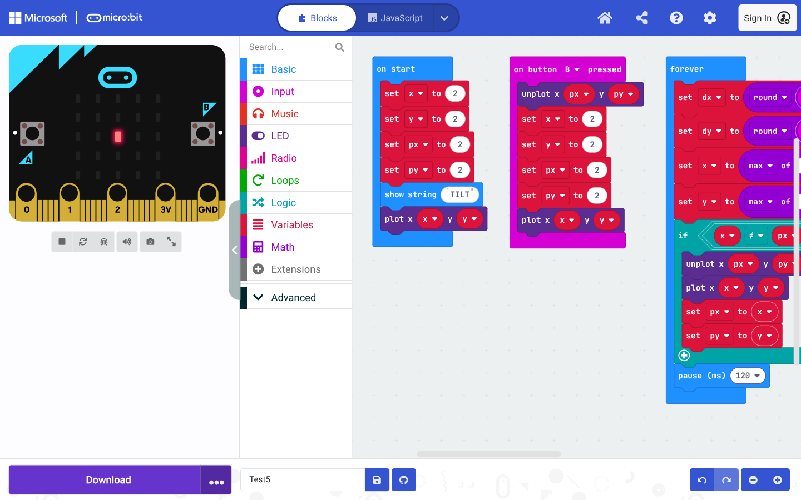

# mbflash

[](https://github.com/tai/mbflash/actions/workflows/ci.yml)
[](https://www.npmjs.com/package/mbflash)



mbflash is a bridge between an AI coding agent and the micro:bit MakeCode
editor. It connects an agentic coding workflow — where a model writes files on
disk and runs commands — to the traditional text and block experience people
actually use in MakeCode: an agent writes ordinary TypeScript, mbflash pushes it
into a live editor tab, and the program reappears as Blocks.

From there mbflash can compile and download the `.hex` and flash it by writing
to the `MICROBIT` volume, so there is no WebUSB pairing step. It can also
search, list and install MakeCode extensions through the editor before loading
code. The CLI itself is dependency-free and talks to the browser over CDP.

```sh
mbflash main.ts
```

That one command:

1. attaches to the MakeCode tab in a CDP-enabled Chromium,
2. loads `main.ts` into the editor and rebuilds the Blocks view,
3. compiles and downloads the `.hex`,
4. copies it to the micro:bit's DAPLink volume and waits for the remount.

## Requirements

- Node.js **22.4+** (uses the built-in `WebSocket` and `fetch`).
- A headed Chromium/Chrome launched with a debugging port:

  ```sh
  chromium --user-data-dir="$HOME/.config/chromium-agent" \
           --remote-debugging-port=9222 \
           --remote-debugging-address=127.0.0.1 \
           "https://makecode.microbit.org/#editor"
  ```

- One or more MakeCode tabs. Select the intended one with `--project`,
  `--target`, or `--index`; ambiguous matches are refused.
- The micro:bit mounted as `MICROBIT` (normally `/run/media/$USER/MICROBIT`).

## Install

From npm:

```sh
npm install -g mbflash
```

From this GitHub repository:

```sh
npm install -g github:tai/mbflash
# or: npm install -g git+https://github.com/tai/mbflash.git
```

For development from a checkout:

```sh
npm link            # puts `mbflash` on PATH, pointing at ./mbflash.mjs
# or run directly:
node mbflash.mjs --help
```

The package has no runtime dependencies and requires Node.js **22.4+**.

## Modes

| Command | What it does |
| --- | --- |
| `mbflash main.ts` | load → Blocks → build → flash |
| `mbflash --load-only main.ts` | load → Blocks (no build/flash) |
| `mbflash --hex-only main.ts` | load → Blocks → build/download (no flash) |
| `mbflash --hex-only` | build/download the code already in the editor |
| `mbflash --flash-only` | build/flash the code already in the editor |
| `mbflash --flash-hex demo.hex` | flash an existing `.hex` (no CDP) |
| `mbflash --project Test1 --switch` | focus the Test1 project (no build) |
| `mbflash --list-extensions` | list the project's dependencies |
| `mbflash --search-extensions servo` | search the live extension gallery |
| `mbflash --extension servo main.ts` | ensure installed → load → build → flash |
| `mbflash --remove-extension servo` | remove an extension from the project |

`--hex-only` with no file is useful when a human has edited Blocks and you just
want a `.hex`. `--flash-only` skips loading but still builds. `--switch` is the
tab manager: select by **project name** or target and bring it to the front.

If `--project` does not match an existing tab, `mbflash` creates a new project
with that name by driving the home page’s **New Project** dialog (open the home
tab, fill `#projectNameInput`, click **Create**, wait for the editor). Use
`--no-create` to make a missing project an error instead. Creation adds about
2–3 s.

## Multiple tabs / projects

All MakeCode tabs have the same URL and title. `mbflash` identifies them by
**CDP target id** and the **MakeCode project name** — the project header /
`pxt.json` name, read from the editor’s project-name field. No sidecar metadata
is written, and the tab title is not used for matching.

```sh
mbflash --list                          # ids, project names, URLs
mbflash --project Test1 --switch        # focus Test1, no build
mbflash --project Test1 main.ts         # load/build/flash Test1 only
mbflash --project Test2 --hex-only      # build Test2's current code
mbflash --project Test3 main.ts         # create Test3 if missing
mbflash --project Test3 --switch        # create + focus an empty Test3
mbflash --label Test1 --switch          # deprecated alias for --project
```

Project names are what MakeCode stores (`pxt.json` `"name"`, and the workspace
header / `headers.name` in IndexedDB when persistent). In this session-only
profile the header lives in renderer memory, so `mbflash` reads the editor’s
project-name field. The tab title is cosmetic; add `--retitle` if you also want
the visible title changed to `MakeCode — <project>`.

If `--project` is missing, `mbflash` creates the project through the home page’s
New Project dialog (same tab, then `#editor`) and the new project is named after
`--project`. `--no-create` turns a missing project into an error.

Duplicate project names: select a specific tab with `--target <id>` or
`--index <n>`.

Practical notes for multiple projects:

- Work one at a time. `mbflash` brings the selected tab to the front by default
  (hidden tabs are throttled by Chromium); `--no-focus` skips that.
- A shared `--download-dir` is fine: MakeCode names the `.hex` after the project
  (`microbit-Test1.hex`, `microbit-Test2.hex`), so sequential builds keep
  distinct files.
- On this profile the MakeCode workspace is **session-only**: each tab's project
  lives in renderer memory and is lost on reload. Keep `main.ts` on disk.
- The tabs share origin storage (`localStorage`), but their in-memory projects
  are independent. If you sign in or enable persistent workspaces, keep to one
  tab per project and verify that the IDB workspace is not being shared.
- Only one board mount is used by default. For multiple boards, pass a different
  `--device` per project.

## Extensions

`mbflash` drives the editor's own Extensions dialog, so extensions can be
searched, listed and installed with just a CDP-enabled browser. There is no
`pxt`/`mkc` dependency and no separate package manager.

```sh
mbflash --list-extensions                 # project dependencies
mbflash --search-extensions servo         # live gallery search
mbflash --extension servo main.ts         # install, then load/build/flash
mbflash --project Demo --extension servo --extension neopixel main.ts
mbflash --project Demo --extension github:microsoft/pxt-max6675 --switch
mbflash --project Demo --remove-extension servo --switch
mbflash --project Demo --remove-extension servo --remove-extension neopixel main.ts
```

- `--extension <spec>` is repeatable and idempotent. It runs **before** the
  source is loaded, so `main.ts` can use the extension's TypeScript API on the
  first try. A missing extension is installed through the gallery and verified
  against `pxt.json`.
- A plain name (`servo`, `neopixel`) searches the gallery by name. A
  `github:owner/repo` or GitHub URL spec opens the package through the gallery;
  the installed dependency is pinned to the gallery's release (for example
  `github:microsoft/pxt-neopixel#v0.7.6`). A requested `#tag` is best-effort:
  mbflash warns if the gallery installed a different version.
- `--list-extensions` marks `core` as builtin, `radio`/`microphone` as default
  dependencies, and everything else as `bundled` or `gallery`. `--json` returns
  the same information as an object.
- `--search-extensions` returns up to 25 results, ranked by exact name, prefix,
  then substring, with a `total` and `truncated` count in `--json` mode.
- `--remove-extension <spec>` is repeatable and idempotent. It uses the editor's
  documented removal flow: switch to JavaScript view, open Explorer, click the
  extension's trash button, and confirm **Remove it**. It verifies the
  dependency is gone from `pxt.json`, then returns to Blocks if the code has no
  TypeScript errors. If code still references the removed extension it stays in
  JavaScript view and warns; update the code or load a new `main.ts`. Removing an
  extension that is still in use will break the build. `--extension` and
  `--remove-extension` are mutually exclusive.
- Extension installs are in-memory like the rest of the session-only workspace:
  a page reload loses them. Keep `--extension` in the command (or use a
  persistent workspace) when a run must be reproducible.
- Installing an extension does not make it safe for the board. V2-only
  extensions (for example `datalogger`) install cleanly on a V1 project and can
  still panic at runtime.

## Options

### Target

```sh
mbflash --cdp 9222 main.ts                 # default 127.0.0.1:9222
mbflash --cdp 192.168.1.50:9222 main.ts    # remote Chromium
mbflash --list                             # show page targets
mbflash --target ABCD1234 main.ts          # exact page id
mbflash --index 2 main.ts                  # second match
mbflash --url makecode main.ts             # URL substring or /regex/
mbflash --title "MakeCode" main.ts         # title substring
mbflash --host makecode.microbit.org main.ts
mbflash --label Test1 --switch             # deprecated alias for --project
mbflash --project Test1 --switch           # focus a project tab
mbflash --project Test1 --switch --retitle # focus + set the visible title
mbflash --project Test3 main.ts            # create Test3 if missing
mbflash --label NoSuch --switch --no-create # error instead of creating
```

The default tab match is the exact hostname `makecode.microbit.org`. If more
than one tab matches (or two tabs have the same project name), the command
fails and lists them; pick one with `--target` or `--index`.

### Output / device

```sh
mbflash --download-dir ./build main.ts     # where Chromium writes the .hex
mbflash --hex-out ./demo.hex main.ts       # copy the built hex here
mbflash --device /run/media/$USER/MICROBIT main.ts
mbflash --wait 90 main.ts                  # flash timeout (s)
mbflash --timeout 180 main.ts              # build/download timeout (s)
```

`--download-dir` defaults to `$XDG_CACHE_HOME/mbflash/hex` (usually
`~/.cache/mbflash/hex`). The new `.hex` is detected without deleting anything
already in that folder. `--hex-out` can be a file or an existing directory.

### Loading

```sh
mbflash --no-blocks main.ts    # load TS only, do not rebuild Blocks
mbflash --roundtrip main.ts    # JS -> Blocks -> JS sanity check
```

`--roundtrip` catches icon/enum loss from the TS → Blocks conversion; a
textual difference is reported as a warning (harmless reformatting is common).

### Automation

```sh
mbflash --json --hex-only main.ts
mbflash --quiet main.ts        # print only the hex path (or "ok")
```

`--json` prints a single object on stdout with `ok`, `mode`, `hex`, `device`,
`markers`, `blocks`, `roundtrip`, `extensions`, `warnings`, and `timings`. On
failure it prints `{ "ok": false, "error": "...", "timings": ... }` and exits
non-zero.

### Skill

```sh
mbflash --skill > SKILL.md     # print the bundled agent skill
```

`--skill` writes the canonical `SKILL.md` that ships with mbflash to stdout. It
needs no browser or board and is the easiest way to install or refresh the agent
instructions for this tool.

## Examples

```sh
# Normal development loop
mbflash main.ts

# Only check that the Blocks conversion works
mbflash --load-only main.ts

# Build a hex for someone else, no board attached
mbflash --hex-only --hex-out ./release.hex main.ts

# Reflash whatever the human has open in Blocks
mbflash --flash-only

# Flash a prebuilt artifact on a machine without a browser
mbflash --flash-hex ./release.hex --device /run/media/$USER/MICROBIT

# A second Chromium on another port
mbflash --cdp 127.0.0.1:9333 --target <id> main.ts
```

## Notes

- **Multiple tabs.** Tabs share an origin and can share persistent storage. On
  a session-only workspace each tab has its own in-memory project, and
  `mbflash` can address them with `--project`/`--target`. With persistent
  workspaces, avoid opening the same project in two tabs; edit one project per
  tab.
- **Session-only projects.** Some profiles keep the project only in page
  memory. The CLI still works, but the project is lost on reload; keep the
  `main.ts` and `.hex` on disk.
- **Extensions.** `--extension` installs through the editor's Extensions
  dialog and verifies `pxt.json` before loading the source;
  `--remove-extension` removes through the JavaScript Explorer and verifies
  `pxt.json` afterwards. Extension state is session-only too; pass the flags on
  every run for reproducibility.
- **V1 vs V2.** The CLI flashes what you give it. V2-only APIs (logo touch,
  `input.soundLevel`, audio) compile for a V1 board and then panic with code
  **927** at boot. Check the board version before using those APIs.
- **Narrow windows.** MakeCode hides the Download control in its mobile
  layout. The CLI temporarily emulates a 1400×900 viewport to reach the menu,
  then clears the override.
- **Flashing** copies the `.hex` to the DAPLink volume and treats “volume
  remounted, hex gone, no `FAIL.TXT`” as success. The copy of the ~1.3 MB
  universal hex is usually the slowest part (~9 s); the flash itself is a few
  seconds.
- **Typical full run** on a demo-sized project: ~2 s load + Blocks, ~4 s build,
  ~15 s flash command (copy + flash), ~21 s total.
- The downloaded filename follows the MakeCode project name; use `--hex-out`
  to give it the name you want.
- **Not a simulator driver.** Like the skill, this tool does not verify
  behaviour in the simulator; the human watches the board.

## Development

```sh
npm test            # CLI tests; no browser or board required
npm run lint        # node --check
npm pack --dry-run  # inspect the npm package contents
```

The test suite covers argument parsing (including extension flags), project/title
semantics, and hex validation. Browser/CDP loading, extension installation and
flashing require a real MakeCode tab and a mounted micro:bit.

## Publishing

This repository is <https://github.com/tai/mbflash>.

```sh
npm test
npm publish
git tag v1.2.3      # use the new version
git push origin main --tags
```

The `Publish npm` workflow runs on a published GitHub release (or manually). It
skips publishing when the version already exists on npm; otherwise it publishes
with the OIDC trusted publisher configured for this repository on npmjs.com, so
no npm secret is stored in GitHub. Keep the repository public for npm
provenance. `npm pack --dry-run` shows exactly what would be published:
`mbflash.mjs`, `README.md`, `SKILL.md`, `LICENSE`, and `package.json`.
